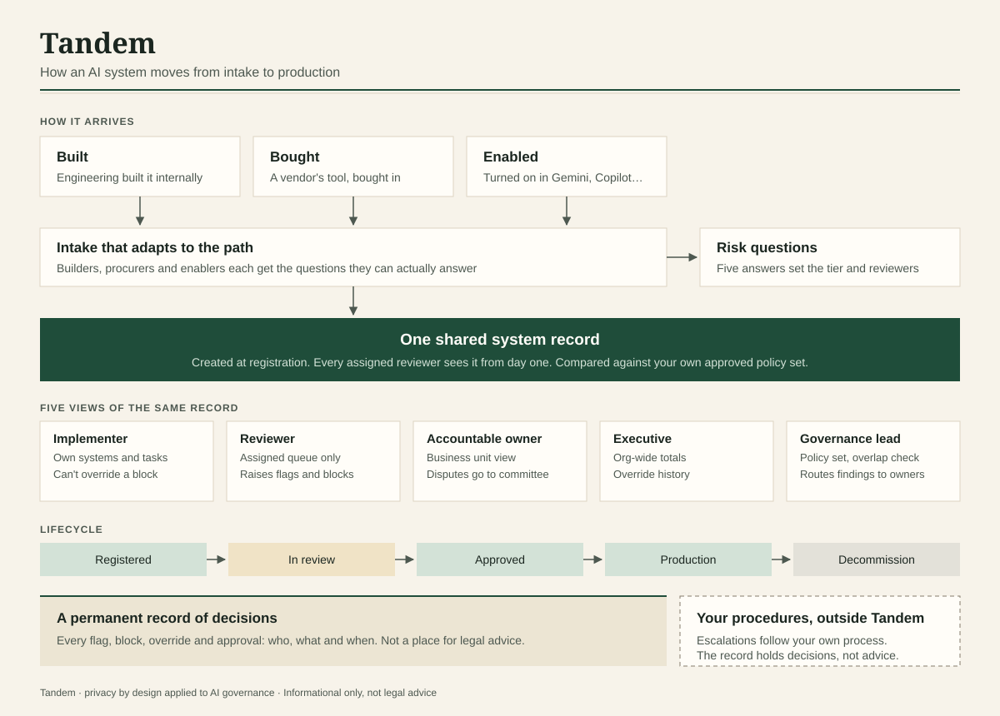

# How Tandem works

*An overview of the prototype for product, engineering and privacy teams. [Open the demo →](https://privacywiz.github.io/In-Tandem/)*

## The problem

Most AI governance runs as a final gate. Privacy, ethics and policy reviewers see a system after the product decisions are made, when changing anything is expensive enough that the review becomes a formality. Tandem flips that: every team works from the same record at intake and stays on it through production.

## Three ways a system arrives

How a system enters the organization decides which questions make sense. Tandem routes intake three ways.

A **built** system was developed internally. Engineering owns it, so the intake asks about training data, model design and deployment.

A **bought** system comes from a vendor. The procurer often can't see the model, so the intake asks what the vendor provided: the data processing agreement, bias audits, system cards.

An **enabled** system arrives as a feature inside a tool you already use: Gemini in Workspace, Copilot in Teams, AI features in a SaaS platform. Someone flips a switch, and there's no purchase to trigger a review. This path gets missed most often. The intake asks what data the feature reaches and how far it rolls out.

Each path shows only the questions that apply, so people answer what they actually know.

## One shared record

The record is created at registration and every assigned reviewer sees it from that moment. Flags, blocks, approvals and overrides all live on it, so reviews happen alongside the work instead of in a handoff at the end.

Tandem compares each system's intake to the organization's **policy set**: the policies the organization has already approved, loaded as one versioned set. Each finding quotes the policy text it relies on and gets one of three labels: conflicts with policy, missing info, or matches policy. The governance lead gives each one a status (blocked, fix plan accepted, assigned, or needs counsel) before the review closes.

Tandem takes the policy set as approved. It doesn't check whether those policies meet the law; that question belongs to the organization's counsel. The governance lead can also run an overlap check that shows where two policies give different instructions for the same case, and both policy owners decide what changes.

## Five views of the same record

The **implementer** view is about tasks: what to document, what's been flagged, what's blocking progress. The **reviewer** view is about judgment: what the implementer claimed, which flags need a decision, which blocks need resolving. The **accountable owner** sees every system in the business unit and can dispute a block, which sends it to the governance committee. The **executive** view adds up the whole registry: risk tiers, open blocks, override history. The **governance lead** keeps the policy set current and works the findings queue.

## A permanent record of decisions

Every flag, block, override and approval is kept, with who did it and when. Nobody can quietly edit history. That holds the people making governance decisions accountable, not just the teams building systems, and when someone asks about a system six months later, the history is there instead of scattered across email.

That permanence is also why the record isn't a place for legal advice. Notes on the record are operational ("asked the vendor for its bias audit on April 3"). When counsel weighs in, the record shows only that counsel was consulted and the date. What counsel said stays with counsel.

## Where counsel fits

Counsel isn't a role in Tandem. When a finding needs legal judgment, it's marked **needs counsel** and the review can't close until someone records that the conversation happened. The conversation itself happens outside the tool.

---

*The idea underneath is privacy by design applied to AI governance: build the safeguards into the process, review throughout the lifecycle instead of at the finish line, and treat the decision record as infrastructure rather than paperwork.*

**Not legal advice.** Tandem is an informational prototype. Using it doesn't create an attorney-client relationship with anyone. Neffy Analytics and everything about it are fictional. Confirm anything legal with your own counsel.
